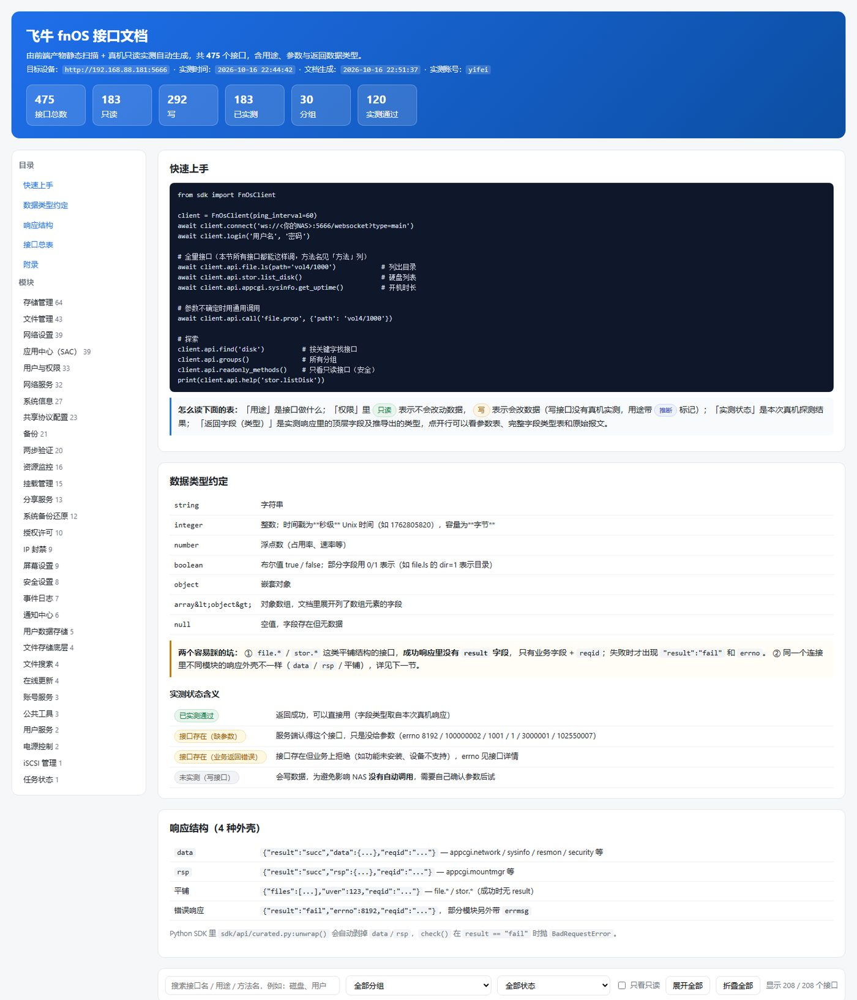
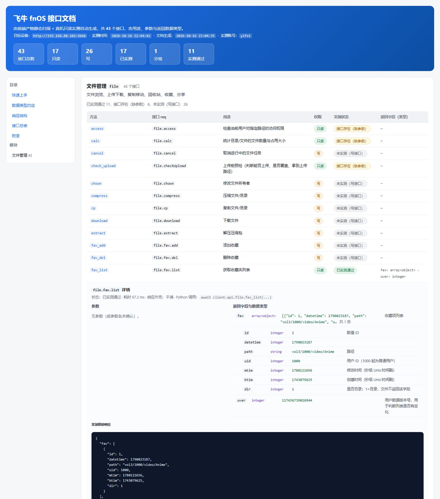

# fnOS Web API 文档

> 本文档用于记录 fnOS Web 的 WebSocket 和 HTTP通信协议与各功能模块接口。

## 概述

- 通信方式：WebSocket HTTP
- 地址示例：`ws://{你的飞牛地址}/websocket?type=main`
- 鉴权方式：Token + 签名
- 响应匹配：通过 `reqid` 对应请求与响应
- 接口总量：真机实测确认 **476 个** WebSocket 接口（只读 184 / 写 292），自动封装在 `client.api.*`；
  另有 `/p` 相册应用的 **151 个 HTTP 接口**（不走 WebSocket，见 [api/http.md](api/http.md)）

## 模块一览
- [通信协议说明](protocol.md)
- [鉴权模块](modules/auth.md)
- [系统信息](modules/sysinfo.md)
- [用户管理](modules/user.md)
- [存储空间](modules/stor.md)
- [文件管理](modules/file.md)
- [MCP Server 与飞牛应用](nasapp.md)：把接口封装成 MCP Server 并打包成 fnOS 应用（界面 + 两种 MCP 连接方式 + 可用接口清单）
- [相册（/p 相册应用）](modules/album.md)（也已内嵌进 `api/interfaces.html`）：相册/照片 REST 接口的功能与用法、鉴权（cookie + authx 签名）、三个完整流程、数据模型与坑
- [分享链接](modules/share.md)：`appcgi.sharesvr.share.link.*` 全链路实测（创建/列表/详情/修改/删除），
  含「参数必须包 `data`」这个坑和分享地址格式

## 抓包与自动封装

- [接口抓取与封装流程](capture.md)：扫描前端 → 真机实测 → 生成封装 → 录制推送，一条龙

## 全量接口文档（自动生成）

- ⭐ **[单文件 HTML 接口文档](api/interfaces.html)**：476 个 WebSocket 接口 + 151 个 HTTP 接口
  一页看完，带搜索与筛选，每个接口一张「用途 / 参数 / 返回字段与数据类型」表 + 实测原始报文。
  用浏览器直接打开，不需要起服务，也不依赖网络。

  
  

- [接口封装总览](api/README.md)：用法 + 分组一览
- [`/p` 相册应用 HTTP 接口](api/http.md)：151 个 REST 接口（相册/照片时间线/人物/AI 识别/地图/
  回收站…），含 `authx` 签名算法与密钥——这个应用不用 WebSocket
- 按分组的接口表（含实测报文样例）：
  `api/file.md`、`api/stor.md`、`api/user.md`、`api/appcgi_network.md`、
  `api/appcgi_sysinfo.md`、`api/appcgi_resmon.md` …（完整列表见总览页）
- [服务端推送事件名](api/events.md)
- [未封装的名字及原因](api/excluded.md)
